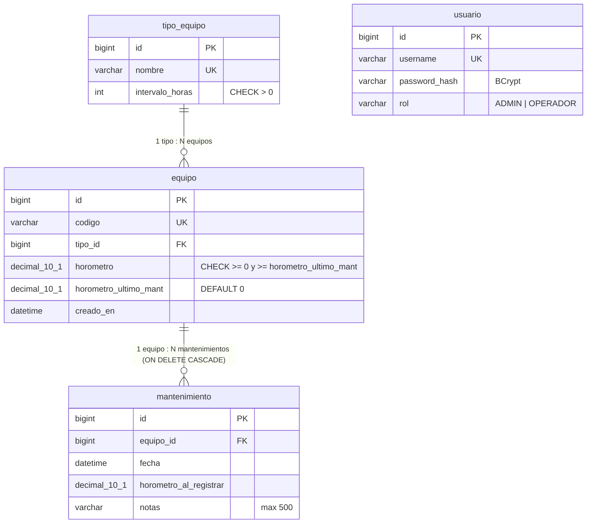

# Registro de equipos mineros

Backend (Java 21 + Spring Boot 3.5) para registrar equipos mineros, saber si **requieren mantenimiento**
y llevar el historial de mantenimientos. El contrato de la API vive en
[`src/main/resources/openapi/openapi.yaml`](src/main/resources/openapi/openapi.yaml) y es la fuente de verdad:
de ahí se generan las interfaces y los DTOs.

- [Qué hace](#qué-hace)
- [Arquitectura](#arquitectura)
- [Modelo de datos](#modelo-de-datos)
- [API](#api)
- [Cómo levantarlo en local](#cómo-levantarlo-en-local)
- [Variables de entorno](#variables-de-entorno)
- [Pruebas y cobertura](#pruebas-y-cobertura)
- [Despliegue (deploy.sh y CI/CD)](#despliegue)
- [Rollback](#rollback)
- [Decisiones y supuestos](#decisiones-y-supuestos)
- [Uso de IA](#uso-de-ia)

## Qué hace

- Alta, consulta, edición y baja de equipos (camiones, excavadoras, perforadoras).
- **Calcula al consultar** si un equipo requiere mantenimiento (no se guarda):
  `requiereMantenimiento = (horometro - horometro_ultimo_mant) >= intervalo_horas del tipo`.
  Se devuelve como booleano y como texto legible (`"OK"` / `"Requiere mantenimiento"`).
- Registrar un mantenimiento guarda el horómetro actual en el historial y **reinicia el ciclo**
  (`horometro_ultimo_mant = horometro`), todo en una sola transacción.
- Reglas: el horómetro no puede bajar al editar (422), el código de equipo es único (409),
  eliminar un equipo borra su historial.
- Autenticación con JWT, errores con un formato único (`ErrorResponse`) y CORS configurable.

**Stack:** Java 21, Maven, Spring Boot 3.5.16, MySQL 8 + Flyway, Spring Data JPA, OpenAPI 3
(`openapi-generator`, contract-first), MapStruct, Lombok, Spring Security + JWT (jjwt), JUnit 5 + Mockito,
ArchUnit, JaCoCo.

## Arquitectura

**Monolito modular**: una sola aplicación, un solo despliegue y una sola base de datos, dividida en **módulos por
funcionalidad**. Cada módulo tiene sus propias subcarpetas por tipo de clase. Las reglas entre módulos las vigila
[`ArquitecturaTest`](src/test/java/com/mineria/equipos/arquitectura/ArquitecturaTest.java) (ArchUnit): si alguien las rompe, el build falla.

```
com.mineria.equipos
├── equipo/
│   ├── controller/        EquipoController (implementa la interfaz generada por OpenAPI)
│   ├── service/           EquipoService (interfaz)
│   │   └── impl/          EquipoServiceImpl (aquí viven las reglas de negocio)
│   ├── repository/        EquipoRepository
│   │   └── projection/    EquipoProjection (lecturas con JOIN al tipo, sin N+1)
│   ├── entity/            Equipo (JPA: solo datos)
│   ├── mapper/            EquipoMapper (MapStruct)
│   └── policy/            MantenimientoPolicy (Strategy) · IntervaloMantenimientoPolicy · EstadoMantenimiento
├── tipo/                  controller · service/impl · repository(+projection) · entity · mapper
├── mantenimiento/         controller · service/impl · repository(+projection) · entity · mapper
├── auth/                  controller · service/impl · repository · entity (Usuario, Rol) · mapper
│   └── security/          JwtService, filtro JWT, SecurityConfig, UsuarioDetailsService, 401/403, admin inicial
├── shared/
│   ├── exception/         GlobalExceptionHandler + TODAS las excepciones (+ ErrorResponseFactory)
│   ├── config/            AppProperties, CORS, beans comunes (Clock)
│   └── health/            /health (controller, service, mapper)
└── EquiposApplication
```

Los DTOs los genera el plugin de OpenAPI en `target/generated-sources` con paquetes fijos
(`com.mineria.equipos.generated.api` y `com.mineria.equipos.generated.model`); no se escriben ni se copian a mano.

| Módulo | Responsabilidad | Depende de (por la interfaz de su `service`) |
|---|---|---|
| `tipo` | Catálogo de tipos y su intervalo de mantenimiento | — |
| `equipo` | Alta, consulta, edición y baja de equipos; calcula si requieren mantenimiento | `tipo` |
| `mantenimiento` | Historial; registrar un mantenimiento reinicia el ciclo del equipo | `equipo` |
| `auth` | Login, JWT, roles y seguridad HTTP | — |
| `shared` | Excepciones, configuración y health, comunes a todos | — |

**Reglas (verificadas por ArchUnit):**

1. Un módulo usa a otro **solo a través de la interfaz de su `service`**. Ejemplo: `MantenimientoServiceImpl` llama a
   `EquipoService.reiniciarCiclo(id)` dentro de la misma transacción. Nunca usa el repositorio, la entidad, la proyección,
   el mapper ni la política de otro módulo.
2. **Sin ciclos**: `mantenimiento` depende de `equipo` y `equipo` depende de `tipo`; nunca al revés.
3. El **controller** depende solo de interfaces de `service`: nunca de repositorios, entidades ni mappers.
4. Las **excepciones** viven solo en `shared/exception`, no repartidas por módulo.
5. Las **entidades solo guardan datos**: ninguna validación ni regla de negocio vive en ellas (ni lanzan excepciones del
   negocio). Todo eso va en el `service` (responsabilidad única): por ejemplo, que el horómetro no sea negativo ni baje, que el
   ciclo de mantenimiento arranque en 0 o que se reinicie al registrar un mantenimiento está en `EquipoServiceImpl`.
6. Como controller, service e impl están en paquetes distintos, las clases son `public`: el control de acceso lo hace
   ArchUnit, no la visibilidad de Java.

Cómo viaja una petición: `Controller → Service (interfaz) → ServiceImpl → Repository → entidad JPA`. Los `GET` leen con
**proyecciones** (una consulta con `JOIN`, sin N+1) y el `Mapper` (MapStruct) las convierte al DTO del contrato; los
servicios de escritura trabajan con la entidad. `requiereMantenimiento` y `estado` no se guardan: el `EquipoMapper`
los calcula al consultar con la `MantenimientoPolicy`.

Patrones usados (con criterio, sin sobreingeniería): **Strategy** (`MantenimientoPolicy`), **Factory** (`Mantenimiento.registrarPara`),
**Builder** (Lombok) y **Mapper** (MapStruct, cero mapeo manual).

## Modelo de datos



Migraciones Flyway en [`src/main/resources/db/migration`](src/main/resources/db/migration) (`V1__`…`V5__`).
`tipo_equipo` arranca con **Camión 250 h, Excavadora 500 h y Perforadora 300 h**. **Nunca se edita una migración ya aplicada**:
los cambios van en una versión nueva.

## API

Contrato completo y navegable en Swagger UI: `http://localhost:8080/swagger-ui.html` (público).

| Método y ruta | Auth | Descripción |
|---|---|---|
| `POST /auth/login` | pública | Devuelve el token JWT |
| `GET /health` | pública | `{status:"UP",version}`; **503** si la BD no responde |
| `GET /tipos` | JWT | Catálogo de tipos |
| `GET /equipos` · `POST /equipos` | JWT | Listar (con estado de mantenimiento) · crear |
| `GET /equipos/{id}` · `PUT /equipos/{id}` | JWT | Consultar · editar (el horómetro no baja) |
| `DELETE /equipos/{id}` | JWT con rol **ADMIN** | Elimina el equipo y su historial |
| `POST /equipos/{id}/mantenimientos` | JWT | Registra el mantenimiento y reinicia el ciclo |
| `GET /equipos/{id}/mantenimientos` | JWT | Historial (el más reciente primero) |

**Validaciones** (definidas en el contrato y generadas): `codigo` 3–30 caracteres `^[A-Za-z0-9-]+$`; `tipoId` entero > 0 y
existente; `horometro` entre 0 y 999999.9 con **un decimal** como máximo; `notas` ≤ 500; `id` del path > 0; propiedades
desconocidas y JSON malformado se rechazan; un número enviado como texto (`"12"`) también.

**Errores:** todos usan `ErrorResponse`: `timestamp`, `status`, `error`, `code`, `message`, `path`, `details[{field,reason}]`.

| HTTP | `code` típicos |
|---|---|
| 400 | `VALIDACION_FALLIDA`, `JSON_INVALIDO`, `PROPIEDAD_DESCONOCIDA`, `PARAMETRO_INVALIDO` |
| 401 | `NO_AUTENTICADO`, `TOKEN_EXPIRADO`, `TOKEN_INVALIDO`, `CREDENCIALES_INVALIDAS` |
| 403 | `ACCESO_DENEGADO` |
| 404 | `EQUIPO_NO_ENCONTRADO`, `TIPO_EQUIPO_NO_ENCONTRADO`, `RUTA_NO_ENCONTRADA` |
| 409 | `CODIGO_DUPLICADO`, `CONFLICTO_DE_DATOS` |
| 422 | `HOROMETRO_INVALIDO` |
| 500 | `ERROR_INTERNO` (sin trazas ni datos internos) |

**Seguridad:** JWT stateless (HS256). Todo requiere `Authorization: Bearer <token>` salvo `/auth/login`, `/health` y Swagger.
Los 401/403 salen con el mismo `ErrorResponse`. CORS con métodos y headers explícitos (incluye `Authorization`).

## Cómo levantarlo en local

Requisitos: **Java 21**, **Maven 3.9+** y MySQL 8 (o Docker).

### Con Docker (recomendado)

```bash
cp .env.example .env        # y cambia los valores (JWT_SECRET de 32+ caracteres, claves, etc.)
docker compose up --build   # o: make up
curl http://localhost:8080/health      # {"status":"UP","version":"local"}
docker compose down                    # conserva los datos (volumen); "down -v" los borra
```

`docker compose` levanta MySQL 8.4 (con volumen y healthcheck) y el backend, que **espera** a que MySQL esté sano.
El proyecto de compose se llama `equipos-mineros`, así sus volúmenes no chocan con los de otros proyectos.

### Sin Docker

```bash
# 1. Una base MySQL 8 vacía (ejemplo)
mysql -uroot -p -e "CREATE DATABASE equipos_mineros CHARACTER SET utf8mb4"

# 2. Variables de entorno (ver tabla de abajo); en bash puedes cargarlas desde .env:
set -a; source .env; set +a

# 3. Arrancar (Flyway crea las tablas y el admin se crea con ADMIN_USER/ADMIN_PASSWORD)
mvn spring-boot:run -Dspring-boot.run.profiles=local      # o: make run
```

Probar el login y un endpoint protegido:

```bash
TOKEN=$(curl -s -X POST localhost:8080/auth/login -H 'Content-Type: application/json' \
  -d '{"username":"admin","password":"<ADMIN_PASSWORD>"}' | sed 's/.*"accessToken":"\([^"]*\)".*/\1/')
curl -s localhost:8080/equipos -H "Authorization: Bearer $TOKEN"
```

Perfiles: `application.yml` (base), `application-local.yml` (logs de depuración) y `application-prod.yml`
(logs sobrios; Swagger apagable con `SWAGGER_ENABLED=false`).

## Variables de entorno

Ver [`.env.example`](.env.example). **No hay claves en el repo**; `.env` está en `.gitignore`.

| Variable | Descripción |
|---|---|
| `DB_URL` | URL JDBC de MySQL (con Docker compose no hace falta: usa el servicio `db`) |
| `DB_USER`, `DB_PASSWORD` | Credenciales de la base de datos |
| `JWT_SECRET` | Secreto de firma. **Mínimo 32 caracteres**: si falta o es corto, la app no arranca |
| `JWT_EXPIRATION_MINUTES` | Duración del token (por defecto 60) |
| `ADMIN_USER`, `ADMIN_PASSWORD` | Usuario administrador inicial. Se crea al arrancar si no existe (si faltan, se avisa en el log y no se crea) |
| `CORS_ALLOWED_ORIGINS` | Orígenes permitidos, separados por coma |
| `PORT` | Puerto HTTP (por defecto 8080) |
| `APP_VERSION` | Tag de la imagen; lo fija el `Dockerfile` y lo expone `/health` (`dev` si no se define) |

## Pruebas y cobertura

```bash
mvn test          # pruebas
mvn verify        # pruebas + cobertura: FALLA si instrucciones o ramas < 90%   (o: make verify)
```

Reporte HTML: `target/site/jacoco/index.html`. **Resultado actual: 99,8 % de instrucciones y 92,0 % de ramas**
(211 pruebas). Se excluye del cálculo solo lo generado (código OpenAPI) y la clase `EquiposApplication`; las entidades sí
cuentan. Las ramas sin cubrir son verificaciones de `null` inalcanzables que genera MapStruct.
Las pruebas replican la misma estructura de paquetes que el código (`src/test/java/...`).

| Qué | Dónde |
|---|---|
| Regla de mantenimiento: justo debajo, exacto, por encima del intervalo y reinicio del ciclo | `equipo/policy/ReglaMantenimientoTest` |
| Servicios y sus reglas de negocio (JUnit 5 + Mockito, patrón **AAA**: Arrange/Act/Assert): horómetro que no baja ni es negativo, ciclo en 0 y reinicio, duplicados, no encontrado | `*/service/impl/*ServiceImplTest` |
| Controllers con MockMvc + seguridad real, validaciones del contrato | `*/controller/*ControllerTest` |
| `GlobalExceptionHandler` y excepciones | `shared/exception/**` |
| JWT: válido, expirado, malformado, firma falsa, ausente; CORS | `auth/security/**` |
| Mappers (incluidos nulos) | `*/mapper/*MapperTest` |
| Repositorios con Flyway real | `*/repository/*RepositoryTest` |
| Flujo completo (login → CRUD → mantenimiento → baja) y rollback conjunto equipo + mantenimiento | `integracion/**` |
| Arquitectura de módulos (acceso entre módulos, ciclos, controllers, entidades solo con datos, excepciones) | `arquitectura/ArquitecturaTest` |
| Script e2e contra `docker compose` | `scripts/e2e.sh` (`make e2e`) |
| `deploy.sh` y su rollback con hosting simulado | `scripts/test/deploy_test.sh` (`make test-deploy`) |

**Repositorios: H2 en modo MySQL, no Testcontainers.** Se eligió H2 para que `mvn verify` corra en cualquier máquina y en CI
sin depender de Docker. Usa las **migraciones reales de Flyway** y `ddl-auto=validate`, así que el esquema y los `CHECK` se prueban.
La contrapartida: no es MySQL de verdad. Para cubrirla, el job `e2e` de CI y `scripts/e2e.sh` corren la API completa contra
**MySQL 8.4 real** vía `docker compose`.

## Despliegue

**Una sola lógica de despliegue:** [`deploy.sh`](deploy.sh) (también `make deploy`) contiene todo, incluido el rollback.
GitHub Actions no reimplementa nada: prepara el entorno y ejecuta `./deploy.sh`.

```
1 Verifica herramientas (git, docker, mvn, railway, curl) y variables     → exit 1 si falta algo
2 mvn verify (pruebas + cobertura ≥ 90%)
3 docker build + push de la imagen etiquetada con el SHA corto (nunca solo "latest")
4 Guarda la versión que está desplegada ahora (la que reporta /health) → .deploy/previous_tag
5 Despliega la nueva (las migraciones Flyway corren al arrancar la app)
6 /health con reintentos (10 × 5 s) y comprueba que la versión es la NUEVA
7 Si 5 o 6 fallan → ROLLBACK automático al tag del paso 4
```

**Códigos de salida:** `0` ok · `1` error antes de tocar producción · `2` falló y el **rollback se ejecutó** (el despliegue
se reporta como fallido) · `3` falló y no había versión previa (primer despliegue) · `4` **el propio rollback falló**.

**Variables de `deploy.sh`:** `RAILWAY_TOKEN`, `RAILWAY_SERVICE`, `APP_URL`, `REGISTRY_IMAGE` (obligatorias);
`RAILWAY_ENVIRONMENT`, `HEALTH_RETRIES` (10), `HEALTH_INTERVAL` (5 s), `HEALTH_TIMEOUT` (5 s), `DEPLOY_STATE_DIR`, y
`SIMULATE_FAILURE` (solo `health`; **desactivado por defecto**, ver [Rollback](#rollback)).

### Hosting: Railway

Railway aloja el backend y la MySQL gestionada. Cómo se despliega una versión concreta: Railway no deja elegir un tag desde su CLI,
así que `deploy.sh` sube una carpeta con un `Dockerfile` de una línea (`FROM ghcr.io/<org>/<repo>:<sha>`) con `railway up`.
**Desplegar y volver atrás son la misma operación con distinto tag**, por eso no hay dos caminos que mantener.
Permite volver a una versión anterior porque **todas las imágenes quedan publicadas con su SHA** en el registro.

Configuración única:

1. En Railway: proyecto con un servicio MySQL y un servicio para el backend. En el backend define las variables de la tabla de
   arriba (`DB_URL`/`DB_USER`/`DB_PASSWORD` apuntando al MySQL de Railway, `JWT_SECRET`, `ADMIN_*`, `CORS_ALLOWED_ORIGINS`) y, en
   *Settings → Deploy*, el **Healthcheck Path** `/health`. Railway inyecta `PORT`.
2. Crea un **Project Token** y la URL pública del servicio.
3. En GitHub → *Settings → Secrets and variables → Actions*: `RAILWAY_TOKEN`, `RAILWAY_SERVICE` (nombre del servicio) y `APP_URL`.
4. La primera vez que se publique la imagen, haz **público** el paquete en GHCR (*Packages → Package settings → Change visibility*) para
   que Railway pueda descargarla. La imagen no contiene secretos (todo llega por variables de entorno).

### CI/CD (GitHub Actions)

- [`ci.yml`](.github/workflows/ci.yml) — en cada push/PR: `mvn verify` (falla si JaCoCo < 90 %) y las pruebas de `deploy.sh`.
- [`deploy.yml`](.github/workflows/deploy.yml) — en push a `main`, jobs encadenados con `needs`:
  `test` → `e2e` (levanta backend + MySQL con compose y valida login, CRUD, regla de mantenimiento, 401/400/404/409/422 y `/health`)
  → `deploy` (solo si `e2e` pasó; ejecuta `./deploy.sh`). Si el script hace rollback, **el job queda en rojo**.
  Los secretos salen solo de GitHub Secrets y `concurrency` evita dos despliegues a la vez.

## Rollback

**Qué pasa cuando algo sale mal:** el paso 4 guarda el tag que está en producción; si el paso 5 (el comando de despliegue) o el 6
(`/health` no queda `UP` con la versión nueva en el tiempo previsto) fallan, el paso 7 **redespliega ese tag**, vuelve a verificar
`/health`, imprime `ROLLBACK ejecutado a <tag>` y termina con código `2`. Si el rollback también falla, el error es muy visible y
el código es `4`. Si era el primer despliegue, dice claramente que no hay a qué volver (código `3`).

**Migraciones compatibles hacia atrás (expandir/contraer).** Flyway no deshace migraciones, y al arrancar la versión nueva su
migración ya se aplicó aunque después se haga rollback. Por eso **cada migración debe poder convivir con la versión anterior del código**:

1. *Expandir* (release N): agregar tablas/columnas **nullable o con `DEFAULT`**. Nunca borrar ni renombrar en el mismo release.
2. Release N+1: el código empieza a usar lo nuevo.
3. *Contraer* (release N+2, cuando ya nadie corre N): recién entonces se elimina lo viejo.

Además `spring.flyway.ignore-migration-patterns=*:future` permite que una imagen anterior arranque aunque la BD ya tenga migraciones que
no conoce. Se comprobó en MySQL real: una versión con solo V1–V5 arrancó contra un esquema que ya tenía V6.

### Demostrar el rollback en vivo

Hace falta que la versión **nueva sea distinta de la que está en producción** (para tener a qué volver):

1. Con `main` desplegado y sano (versión **A**), crea una rama con un cambio mínimo (por ejemplo, un comentario) y súbela:
   `git switch -c demo-rollback && git commit --allow-empty -m "chore: demo de rollback" && git push -u origin demo-rollback`
2. En GitHub → *Actions → Deploy → Run workflow*, elige la rama **demo-rollback** y marca **`simulate_failure = true`**.
3. Observa el job `deploy`. Es el mismo `deploy.sh` y deja en el log evidencia de cada fase:
   ```
   ==> PASO 4/7 Guardando la versión actualmente desplegada      ← versión previa guardada: A
   ==> PASO 5/7 Desplegando B
   ==> PASO 6/7 Verificando /health y la versión desplegada
        SIMULATE_FAILURE=health: la verificación apunta a .../__fallo_simulado__/health ...
        Health intento 1/24 ... 24/24: http=404
   ==> PASO 7/7 ROLLBACK (motivo: la versión B no pasó la verificación de salud)
        Volviendo a la versión previa A...
        Health OK: la versión A está arriba y la base de datos responde.
        ROLLBACK ejecutado a A
   ```
4. El job termina **en rojo** (código 2) aunque el servicio quedó sano en la versión A: un despliegue fallido nunca se reporta como exitoso.
   Confírmalo con `curl $APP_URL/health` → `"version":"A"`.

La simulación apunta la verificación de la versión nueva a una URL que no existe; **no rompe nada real**. Con `simulate_failure` apagado
(el valor por defecto, y siempre en los despliegues por push) el flujo es normal. En local:
`SIMULATE_FAILURE=health ./deploy.sh`.

### Pruebas del rollback

[`scripts/test/deploy_test.sh`](scripts/test/deploy_test.sh) prueba el script real con `git`, `docker`, `mvn`, `railway` y `curl`
simulados (un hosting en memoria que sabe qué tag está corriendo): éxito → `0`; falla de health → rollback al tag previo y `!= 0`;
falla simulada; falla del comando de despliegue; versión nueva que no toma el tráfico; **falla del rollback → código propio `4`**;
variable o herramienta faltante → `1` con mensaje claro; **segunda ejecución seguida sin cambios no redespliega**; primer despliegue
con y sin éxito; que no se filtre el token. Corre en `ci.yml` y en el job `test` de `deploy.yml`.

## Decisiones y supuestos

- **Spring Boot 3.5.16** (última de la rama 3.x, compatible con Java 21); springdoc 2.8, MapStruct 1.6, jjwt 0.12.
- **Fechas** (`creadoEn`, `fecha` del mantenimiento) en UTC con fecha y hora (`DATETIME`); en el JSON salen en ISO-8601.
- **`horometro_ultimo_mant` arranca en 0**, como indica el modelo. Un equipo dado de alta con un horómetro ≥ su intervalo
  aparece de inmediato como "Requiere mantenimiento".
- **Registrar mantenimiento**: el body es obligatorio pero `notas` es opcional (`{}` es válido). Se permite registrarlo aunque
  el equipo todavía no lo requiera.
- **`tipoId` inexistente al crear o editar → 404** (`TIPO_EQUIPO_NO_ENCONTRADO`), siguiendo la lista de excepciones del enunciado.
- **Roles:** `ADMIN` y `OPERADOR`. Solo `ADMIN` puede borrar equipos (da sentido al 403). El único usuario que se crea solo es el
  admin inicial; no hay endpoints de gestión de usuarios (un `OPERADOR` se agrega por SQL).
- **`/health` incluye `version`** además de `status`: el despliegue lo usa para validar que corre la versión nueva y para saber a qué
  versión volver. Si la BD cae responde `503 {"status":"DOWN"}`.
- **`GET /equipos` sin paginación** (el enunciado no la pide). Los errores siempre traen `details` (vacío si no aplica).
- **Mensajes de validación en español** de forma determinista (`spring.web.locale=es`), sin depender del idioma del servidor.
- **Código duplicado:** se valida antes de guardar y, ante dos altas simultáneas, la restricción única de la BD se traduce a
  `CODIGO_DUPLICADO` (409) en el adaptador de persistencia.
- **`mvn verify` se ejecuta dos veces en el flujo de despliegue** (job `test` y paso 2 de `deploy.sh`): es deliberado, porque
  el script debe poder ejecutarse solo, en cualquier máquina, con las mismas garantías.
- **Integración con Railway:** la lógica de `deploy.sh` está probada de punta a punta con un hosting simulado, y el flujo de
  contenedor (imagen, compose, `/health`, migraciones) se probó con Docker y MySQL reales. **El comando `railway up --ci` contra un
  proyecto Railway real no se ha podido ejecutar en este entorno**: antes del primer despliegue real conviene correrlo una vez y
  ajustar `HEALTH_RETRIES` según lo que tarde Railway en construir y arrancar.
- **Monolito modular (refactor de estructura, sin cambios de comportamiento).** Se pasó de capas hexagonales a módulos por
  funcionalidad. Desaparecen el dominio separado, los puertos, los adaptadores y los *views*: cada módulo tiene su `entity`
  JPA (solo datos), su `repository`, su `service` (interfaz + `impl`) y su `mapper`.
  El contrato `openapi.yaml`, las migraciones y las respuestas de la API no cambiaron.
- **DTOs en un solo paquete generado.** Se generan con una única ejecución del plugin en
  `com.mineria.equipos.generated.api|model`. Separarlos por módulo exigiría varias ejecuciones del plugin sobre el mismo
  contrato y complicaría el build sin aportar nada; se dejan juntos. Los servicios devuelven esos DTOs ya mapeados.
- **`equipo` guarda `tipoId`, no una relación JPA con `tipo`.** Así no depende de la entidad del módulo `tipo`: para validar un tipo
  usa `TipoService.verificarExiste`, y las lecturas unen el tipo con un `JOIN` por `tipo_id` dentro de la consulta de la
  proyección (la base de datos es única). Es un acoplamiento de datos de solo lectura, no de código Java.
- **`EquipoService.reiniciarCiclo(id)` devuelve el horómetro** en el que reinició el ciclo: así `mantenimiento` guarda ese mismo
  valor en el historial sin leer la entidad de `equipo`. Todo corre en la misma transacción y se prueba el rollback conjunto.
- **Carpetas fuera de la lista del enunciado:** `shared/health` (el `/health` no pertenece a ningún módulo de negocio) y
  `ErrorResponseFactory` dentro de `shared/exception` (la comparten el handler global y los 401/403 de seguridad).
  `TokenJwtException` se movió a `shared/exception` porque las excepciones no pueden definirse fuera de esa carpeta.
- **Login con `UserDetailsService` y `PasswordEncoder`** de Spring Security (`UsuarioDetailsService`), en lugar de un hasher propio.
  El error sigue siendo el mismo para usuario inexistente y clave incorrecta.
- **Entidades solo con datos; las reglas en el `service`.** Validaciones y reglas (horómetro no negativo ni decreciente, ciclo en 0 y
  su reinicio) viven en `EquipoServiceImpl`; el armado de las entidades lo hacen los mappers (MapStruct). ArchUnit impide que una
  entidad dependa de excepciones, services, políticas o mappers.
- **La cobertura no excluye las entidades**: cuentan igual que el resto del código.
- El volumen de `docker compose` y el nombre del proyecto (`equipos-mineros`) son propios de este repo.

## Uso de IA

Este proyecto se construyó con **Claude Code** (Anthropic, modelo **Claude Sonnet 5.5**) como asistente de programación en terminal:
diseño de la arquitectura, contrato OpenAPI, migraciones, código, pruebas, Docker, `deploy.sh`, workflows de CI/CD y este README.
El flujo fue iterativo, en commits pequeños, ejecutando el build y las pruebas reales (incluido MySQL 8 y Docker) después de cada etapa.
Todo el código y la configuración deben ser revisados por una persona antes de llevarlos a producción.
